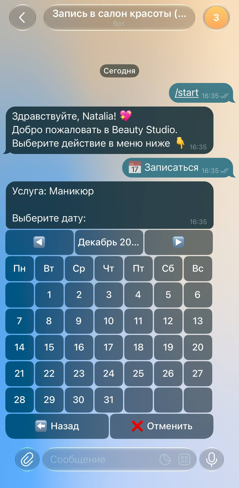
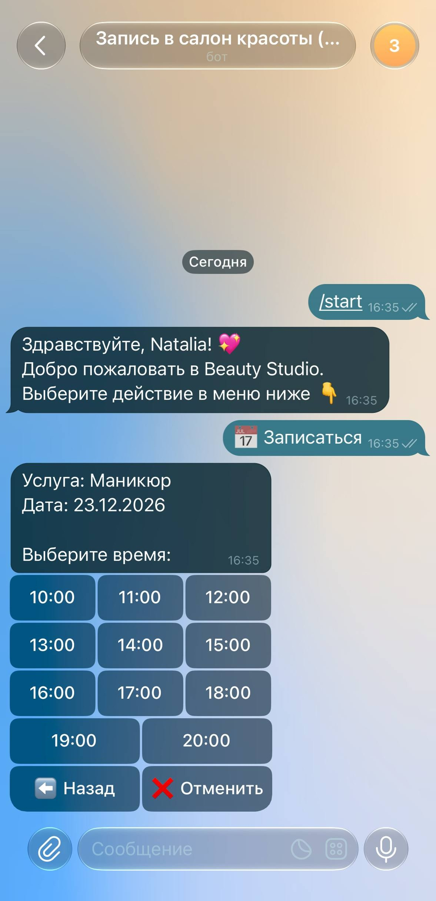
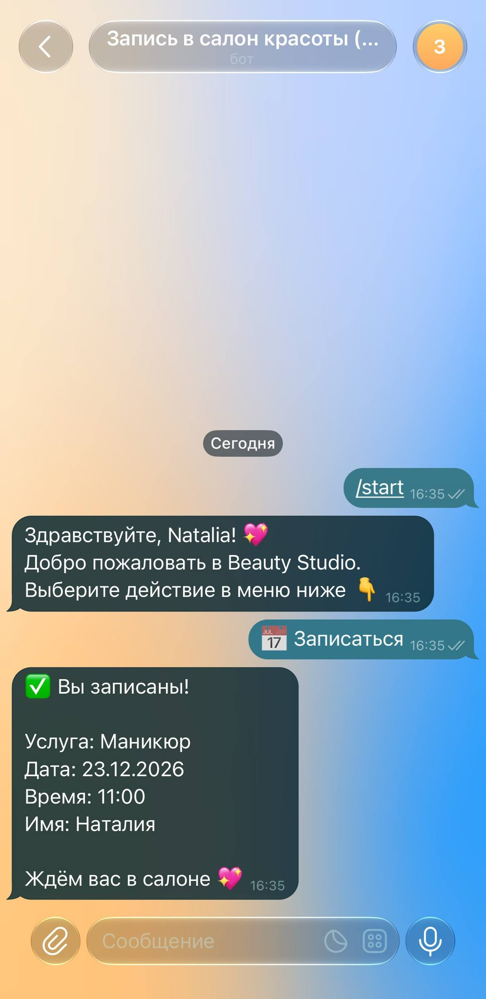
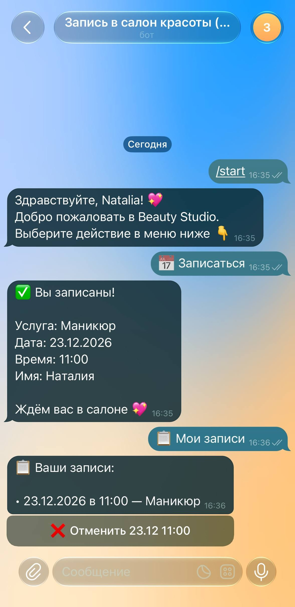
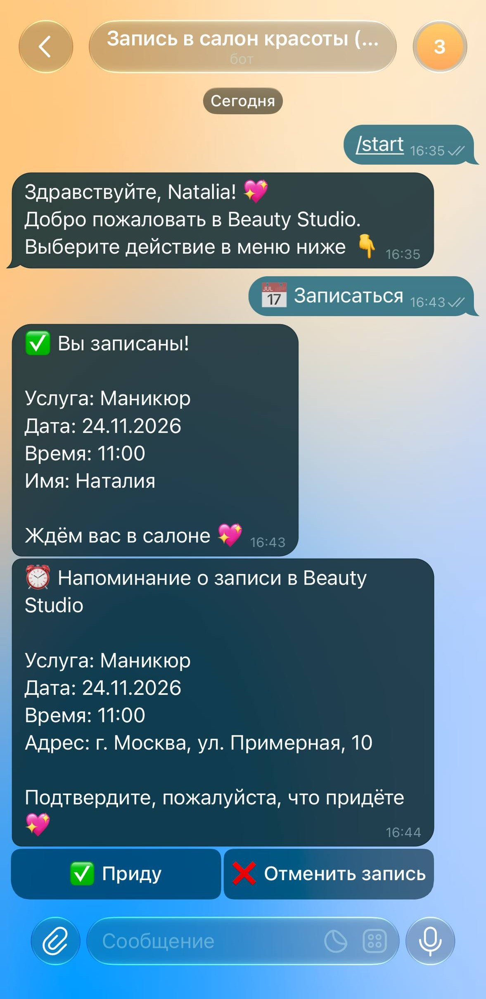

# 💅 Telegram-бот записи в салон красоты

Бот для онлайн-записи клиентов в салон красоты, барбершоп, студию маникюра и другие сферы услуг.
Клиент сам выбирает услугу, дату и время, а администратор получает уведомление в Telegram.

Написан на **Python** и **aiogram 3**, данные хранятся в **SQLite**.

## 📸 Как это выглядит

<p>
  
  
  
</p>
<p>
  
  
  
</p>

## ✨ Возможности

**Для клиента:**
- Список услуг с ценами и длительностью
- Пошаговая запись: услуга → дата (календарь) → время → имя и телефон
- Кнопки «Назад» и «Отменить» на любом шаге
- Раздел «Мои записи» с отменой записи (с подтверждением)
- Напоминание о визите за 24 часа с кнопками «Приду» и «Отменить запись»
- Контакты, адрес и часы работы салона

**Для администратора:**
- Мгновенное уведомление о каждой новой записи и каждой отмене
- Команда `/admin`: записи на сегодня, на завтра и ближайшие

**Надёжность:**
- Защита от двойной записи на одно и то же время
- Проверка введённых имени и телефона
- Корректная обработка устаревших кнопок и нажатий меню посреди записи
- Функции администратора доступны только владельцу (проверка по Telegram ID)
- Токен и настройки хранятся в `.env`, а не в коде


## 🛠 Технологии

- Python 3.11+
- [aiogram 3](https://docs.aiogram.dev/): асинхронный фреймворк для Telegram-ботов
- SQLite + aiosqlite
- FSM (машина состояний) для пошагового сценария записи
- Фоновая задача для отправки напоминаний

## 📁 Структура проекта

```
salon-booking-telegram-bot/
├── main.py             # запуск бота
├── config.py           # настройки салона: услуги, цены, часы работы
├── utils.py            # уведомления администратору
├── reminders.py        # напоминания клиентам
├── handlers/           # обработчики: запись, мои записи, админ-панель
├── keyboards/          # кнопки: меню, календарь, выбор времени
├── database/           # работа с базой данных SQLite
├── requirements.txt    # список библиотек
└── .env.example        # пример файла с настройками
```

## 🚀 Как запустить у себя

1. Скачайте проект и откройте его папку в терминале.

2. Создайте виртуальное окружение и установите библиотеки:
   ```bash
   python -m venv venv
   venv\Scripts\activate
   pip install -r requirements.txt
   ```
   На Mac и Linux вместо второй команды используйте `source venv/bin/activate`.

3. Создайте бота у [@BotFather](https://t.me/BotFather) и получите токен.

4. Узнайте свой Telegram ID, например у бота [@userinfobot](https://t.me/userinfobot).

5. Скопируйте файл `.env.example` в `.env`:
   ```bash
   copy .env.example .env
   ```
   Откройте `.env` и впишите свои данные:
   ```
   BOT_TOKEN=токен_от_BotFather
   ADMIN_ID=ваш_telegram_id
   ```

6. Запустите бота:
   ```bash
   python main.py
   ```

## ⚙️ Настройка под свой бизнес

Название салона, адрес, телефон, часы работы, список услуг с ценами, время сеансов
и время напоминания меняются в одном файле `config.py`, код править не нужно.

## 💼 Нужен такой бот для вашего бизнеса?

Могу сделать Telegram-бота под вашу задачу: запись клиентов, каталог и заказы, рассылки,
приём заявок, интеграции с Google-таблицами и CRM.

📩 Telegram: @ntlbbkv

## 👩‍💻 Автор

[ntlbbkv](https://github.com/ntlbbkv)